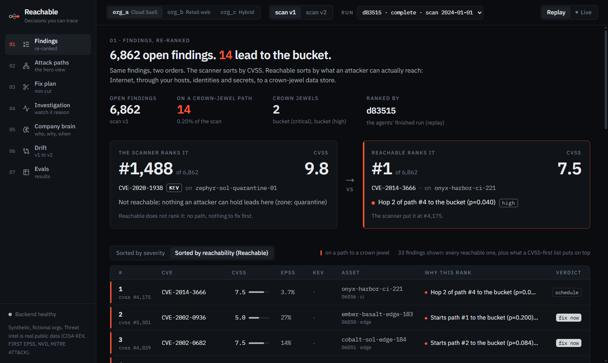
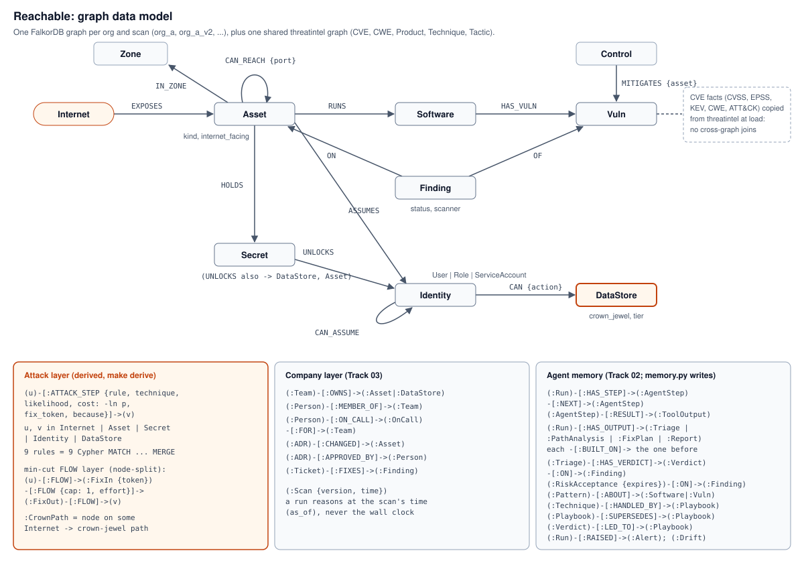
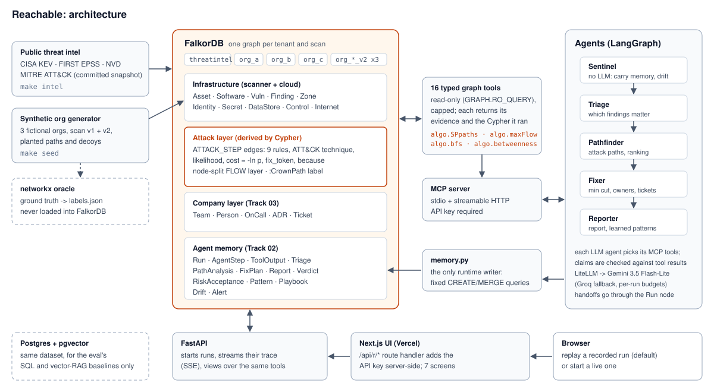

# Reachable

**Security triage by what an attacker can actually reach, not by CVSS.**
Reachable loads a company's infrastructure, identities, secrets and scanner findings into
FalkorDB, derives every attacker step as a graph edge, and has agents find the real
Internet -> crown-jewel attack paths and the smallest set of fixes that cuts all of them.

**Live demo: https://reachable-web-sand.vercel.app** (replay mode: plays recorded agent runs, no model call needed)



## The problem, and the result

A scanner sorts 6,862 findings by severity. But severity is a property of one bug, and
risk is a property of *paths*: can an attacker get from the Internet, through your hosts,
keys and roles, to the data that matters? Answering that is a graph problem.

In the demo org, only 14 of 6,862 open findings lie on an attack path, scattered between
scanner ranks #1,487 and #5,581: a CVSS-sorted list puts about 1,500 findings ahead of the
first of them. Reachable's #1 is a **CVSS 7.5 the scanner ranks #4,175**: a bug on an
internal CI runner that three separate attack paths funnel through, so one patch closes
three paths. And the same 9.8 KEV bug (Ghostcat, CVE-2020-1938) appears at scanner ranks
#1,487 and #1,488: one copy starts an attack path, the other sits in a quarantine zone that
nothing leads to. Same CVE, same score, opposite answers.

**Take the graph away and the product stops working.** Same agent, same model, same prompt,
with the FalkorDB tools answering "unavailable": attack-path recall in the top 10 goes from
**100% to 0%** ([ablation](evals/results/ablation.md)).

## Tracks entered

All three:

| Track | How Reachable fits |
|---|---|
| **01 Agents That Act on Connected Data** | Agents pick graph tools over MCP (`algo.SPpaths`, `algo.maxFlow`, `algo.bfs`, `algo.betweenness`), rank findings by multi-hop reachability, choose a min-cut fix set, verify it on a copy of the graph, and show the evidence for every hop. |
| **02 Agent Memory and Coordination** | Episodic, semantic and procedural memory live in each tenant's graph; agents hand off only through the `Run` node; a rescan starts from the last scan's memory (8 verdicts carried, 1 finding investigated vs 9 cold, 16 tool calls vs 28: [Gate B](evals/results/memory_lift.md)). |
| **03 Company Brain** | Teams, people, on-call rotas, ADRs and tickets sit in the same graph as the infrastructure, so every fix comes with its owner, who is on call now, and the decision that opened the exposure (who approved it, when). |

## Quickstart (local, from a clean clone)

**Prerequisites:** Docker with Compose v2, [uv](https://docs.astral.sh/uv/) (it installs
Python 3.12 for you), Node.js 20.9+ with npm, and GNU make (Windows: `winget install
ezwinports.make`). Free host ports 6380, 3001, 5434, 8001, 8002 and 3000. On Windows,
clone to a short path (e.g. `C:\src\reachable`): LiteLLM downloads a tokenizer into
`.venv`, and past 260 characters that write fails and a real-model run comes out
`degraded` (0 tokens).

**Keys:** `MCP_API_KEY` in `.env` protects the API and the MCP server (any random string
of 16+ characters; the UI uses the same key). `GEMINI_API_KEY` is needed only for runs
with a real model ([free key](https://aistudio.google.com/apikey)); everything else,
including a full agent run with the stub model, works without it.

```bash
git clone https://github.com/Atharv5873/reachable.git && cd reachable
cp .env.example .env    # set MCP_API_KEY and the two passwords; add GEMINI_API_KEY if you have one
```

| step | what it does | what you should see |
|---|---|---|
| `make up` | builds and starts FalkorDB (+ Browser), Postgres, the API and the MCP server; waits until healthy | four containers `Healthy` (first build: a few minutes) |
| `make intel` | loads the committed threat-intel snapshot into graph `threatintel` (offline, 2 s) | `threatintel loaded: cve: 3136 ... technique: 9, tactic: 7` |
| `make seed` | generates the three synthetic orgs (v1 + v2 scans), writes the oracle's labels, loads FalkorDB + Postgres, derives the attack layer (about 35 s) | one line per org (`org_a ... "planted_paths": 9, "min_cut": 7`), then one `derive` line per graph (`org_a ... "attack_steps": 30629 ... "idempotent": true`) |
| `make triage ORG=org_a` | the agents (Triage, Pathfinder, Fixer, Reporter) on org_a scan v1 with the real model (needs `GEMINI_API_KEY`; ~15 s, about a cent) | one line per agent, then `run_id: org_a:run:<id> (complete, ...)`, `served by: primary=gemini/...` and the report path `runs/<id>.md` |
| *or* `make triage FAKE=1` | the same with a deterministic stub model: no key, no network | the same shape, `served by: fake=...`; the UI labels the run `stub model` |

Runs remember: a second run on the same scan carries the first run's verdicts instead of
re-investigating (that is the episodic memory). To give a real run a cold start after a
stub run, `make reset-memory ORG=org_a SCAN=v1` first; `make seed` resets everything.

Then the UI:

```bash
cp apps/web/.env.example apps/web/.env.local   # set REACHABLE_API_KEY to your MCP_API_KEY
make web-install && make web                   # http://localhost:3000
```

Open <http://localhost:3000/findings>: the run you just made ranks the findings (the top
bar's run picker lists every run). The screens are in demo order (01 Findings ... 07 Evals).
Drift (06) shows the v1 -> v2 path diff straight away; its memory panel fills after a v2
run (`make drift ORG=org_a && make triage ORG=org_a SCAN=v2`, or the analyst loop on that
screen in Live mode). The FalkorDB Browser is at <http://localhost:3001> (password:
`FALKORDB_PASSWORD`). npm's `install-scripts` warning during `web-install` is harmless.

> **Try the live site instead.** https://reachable-web-sand.vercel.app needs no setup. To
> see exactly what the demo video shows, pin the recorded runs: org_a
> [findings](https://reachable-web-sand.vercel.app/findings?org=org_a&scan=v1&run=org_a:run:d83515921bd8),
> [attack paths](https://reachable-web-sand.vercel.app/paths?org=org_a&scan=v1&run=org_a:run:d83515921bd8&f=org_a:finding:06856),
> [fix plan](https://reachable-web-sand.vercel.app/fixes?org=org_a&scan=v1&run=org_a:run:d83515921bd8),
> [drift v1 -> v2](https://reachable-web-sand.vercel.app/drift?org=org_a&scan=v2&run=org_a_v2:run:6fe91bc3bdbf).
> Best on a laptop screen.

More: `make test` (185 tests; integration tests skip if FalkorDB is down), `make gate-a`
(grades the graph tools against the oracle, no LLM), `make eval-score` (recomputes every
eval table from the committed raw outputs, no keys), `make down` (stop; data kept).
The compose project is named `reachable`, so a second checkout on the same machine shares
its containers and volumes (`make seed` in one resets the other).

## The graph data model



**One graph per tenant and scan.** Each org is its own FalkorDB graph (`org_a`, and the
week-later rescan `org_a_v2`), holding that org's infrastructure, attack layer, company
layer and agent memory together. Tenants cannot see each other, and a rescan is a new
graph that memory is carried into, so v1 and v2 can be diffed. A shared `threatintel`
graph holds the public intel (`CVE`, `CWE`, `Product`, `Technique`, `Tactic`); FalkorDB
does not join across graphs, so the facts a step needs (CVSS, EPSS, KEV, CWE, attack
vector) are copied onto each org's `Vuln` nodes at load time.

* **Infrastructure:** `Internet -[:EXPOSES]-> Asset`, `Asset -[:CAN_REACH {port}]-> Asset`,
  `Asset -[:RUNS]-> Software -[:HAS_VULN]-> Vuln`, `Finding -[:ON]-> Asset`,
  `Finding -[:OF]-> Vuln`, `Control -[:MITIGATES {asset}]-> Vuln`, `Asset -[:HOLDS]-> Secret
  -[:UNLOCKS]-> Asset|Identity|DataStore`, `Asset -[:ASSUMES]-> Identity`,
  `Identity -[:CAN_ASSUME]-> Identity`, `Identity -[:CAN]-> DataStore {crown_jewel, tier}`.
* **The attack layer (`ATTACK_STEP`).** Nine rules ([`attack_rules.py`](packages/core/src/reachable_core/attack_rules.py)),
  each one Cypher query, turn structural facts into attacker steps: an edge between attack
  states (`Internet`, `Asset`, `Secret`, `Identity`, `DataStore`) carrying the rule, its
  ATT&CK technique, `likelihood`, `cost = -ln(likelihood)` (so the shortest path is the most
  likely one), the `fix_token` that removes it, and `because` (the evidence node ids). Only
  `status = 'open'` findings produce steps, so fixing one removes it. Next to it,
  a node-split `FLOW` layer (each fix token becomes a `FixIn -> FixOut` gate of capacity 1,
  or its effort) for max-flow, and a `:CrownPath` label on nodes that lie on some
  Internet -> crown-jewel path.
* **Company layer:** `Team -[:OWNS]-> Asset|DataStore`, `Person -[:MEMBER_OF]-> Team`,
  `Person -[:ON_CALL]-> OnCall -[:FOR]-> Team`, `ADR -[:CHANGED]-> Asset`,
  `ADR -[:APPROVED_BY]-> Person`, `Ticket -[:FIXES]-> Finding`, and a `Scan` node whose time
  is the clock every run reasons at (`as_of`).
* **Agent memory:** `Run -[:HAS_STEP]-> AgentStep -[:NEXT]-> AgentStep -[:RESULT]-> ToolOutput`;
  `Run -[:HAS_OUTPUT]-> Triage | PathAnalysis | FixPlan | Report`, each `-[:BUILT_ON]->` the
  previous agent's output; `Triage -[:HAS_VERDICT]-> Verdict -[:ON]-> Finding`;
  `RiskAcceptance {expires} -[:ON]-> Finding`; `Pattern -[:ABOUT]-> Software|Vuln`;
  `Technique -[:HANDLED_BY]-> Playbook -[:SUPERSEDES]-> Playbook`; `Verdict -[:LED_TO]-> Playbook`;
  `Run -[:RAISED]-> Alert`, and `Drift`.

org_a v1 at a glance: 1,758 assets, 6,862 open findings, 3,453 software instances, ~30,600
`ATTACK_STEP` edges, 14 findings on a crown-jewel path, 9 attack paths, min cut 7.

## The Cypher and graph algorithms it depends on

All tools are in [`packages/graph/src/reachable_graph/tools.py`](packages/graph/src/reachable_graph/tools.py)
(and `company_tools.py`), run read-only (`GRAPH.RO_QUERY`), and return the Cypher they ran
with their result, so every answer in the UI can show its query.

| what | FalkorDB feature | what it does for the product |
|---|---|---|
| attack paths | `algo.SPpaths` over `ATTACK_STEP`, `weightProp: 'cost'` | the k most likely Internet -> crown-jewel paths (cost = -ln p, so lowest total cost = highest probability) |
| minimum fix set | `algo.maxFlow` over the node-split `FLOW` layer | max flow = the minimum number of fixes (or minimum effort); the cut itself is recovered from the residual graph and must equal the max flow, or the tool refuses to answer |
| blast radius | `algo.bfs(a, depth, 'ATTACK_STEP')` | everything an attacker holding one node can reach next |
| choke points | `algo.betweenness` restricted to `:CrownPath` nodes | the hops most attack paths go through |
| fix verification | `GRAPH.COPY` to a scratch graph, delete the fixed steps, re-run `algo.SPpaths` | proves a fix set disconnects every crown jewel before it is recommended |
| derivation | 9 `MATCH ... MERGE (src)-[:ATTACK_STEP]->(dst)` rules, then 3 `CREATE` passes for `FLOW` | builds the attack layer and the max-flow network from the raw facts |
| ranking | path-criticality over the paths above | a finding's rank = the tier-weighted number of distinct crown paths its step lies on ([`criticality.py`](packages/graph/src/reachable_graph/criticality.py)) |
| drift | `algo.SPpaths` on v1 and v2 | new / closed / cost-changed crown paths between two scans; an alert only for a brand-new path |
| company + memory | parameterised `MATCH` on the company and memory labels | owners and on-call at the scan's time, the ADR that opened an exposure, live vs expired risk acceptances, the playbook version in force |

One derivation rule (`exploit_remote_service`, T1210):

```cypher
MATCH (src:Asset)-[r:CAN_REACH]->(dst:Asset)-[:RUNS]->(s:Software)-[:HAS_VULN]->(v:Vuln),
      (f:Finding)-[:ON]->(dst), (f)-[:OF]->(v)
WHERE v.av IN $network_vectors
  AND (size(s.ports) = 0 OR r.port IN s.ports)
  AND NOT (:Control)-[:MITIGATES {asset: dst.id}]->(v)
WITH DISTINCT src, dst, f.id AS token, v.likelihood AS lk, [f.id, v.id, s.id] AS because
MERGE (src)-[e:ATTACK_STEP {key: $rule + '|' + token + '|' + src.id + '|' + dst.id}]->(dst)
SET e.rule = $rule, e.technique = $technique, e.fix_token = token,
    e.likelihood = lk, e.cost = -log(lk), e.because = because
```

The attack paths and the min cut:

```cypher
MATCH (s:Internet {id: $source}) MATCH (t:DataStore {crown_jewel: true})
CALL algo.SPpaths({sourceNode: s, targetNode: t, relTypes: ['ATTACK_STEP'],
                   weightProp: 'cost', pathCount: $k, maxLen: $max_hops})
YIELD path, pathWeight
RETURN t.id, pathWeight, path ORDER BY pathWeight

MATCH (s:Internet) MATCH (t:DataStore) WHERE t.id IN $targets
WITH s, collect(t) AS ts
CALL algo.maxFlow({sourceNodes: [s], targetNodes: ts,
                   capacityProperty: $cap_prop, relationshipTypes: ['FLOW']})
YIELD edges, edgeFlows, maxFlow
RETURN maxFlow, edges, edgeFlows
```

Not used: WCC and community detection (the product's questions are about paths and cuts,
not clusters). The derivation is checked against an independent networkx oracle: a test
asserts the two produce identical Internet -> crown-jewel path sets, hop for hop.

## How the agents and memory work



A run is a LangGraph pipeline of up to five agents: **Sentinel** (no LLM, first on a rescan: it carries
memory into the new graph, flags arrivals a learned pattern matches, diffs the crown paths
and raises an alert only for a new one), **Triage**, **Pathfinder**, **Fixer** and
**Reporter**. The run itself makes the deterministic graph calls (findings, paths, both
min cuts, owners, the fix simulation); each LLM agent is shown the MCP schemas of its own
tool subset (Pathfinder: `attack_paths`, `blast_radius`, `why_step`; Fixer: `owners`,
`decision_trail`, `simulate_fix`), chooses its follow-up calls, and judges. Every call goes
over MCP. The model's answer is grounded against the real tool results: ids, numbers and
claims that are not in them are dropped.

Agents never call each other. Each writes its output to the `Run` node and the next reads
it back; every tool and model call is an `AgentStep` with the Cypher it ran, which is what
the UI streams (SSE) and replays. `memory.py` is the only code that writes to an org graph
at runtime (fixed, parameterised queries on memory labels; a test proves infrastructure is
never touched). Three kinds of memory change what the next run does:

* **episodic:** a finding whose earlier verdict still stands is carried, not re-investigated; a risk acceptance suppresses its finding until it expires;
* **semantic:** the Reporter learns "image X was the way in" patterns, and the next scan's Sentinel flags new hosts built from that image on arrival;
* **procedural:** an analyst's rejected verdict with a reusable reason becomes a new playbook version (the old one kept, `SUPERSEDES`) that later runs apply.

Models: Gemini 3.5 Flash-Lite through LiteLLM (Groq fallback), with per-run budgets. A real
run is about 6 model calls and one or two cents.

## The eval: does the graph earn its place?

The same labelled findings, ranked five ways on six scans (three development v1, three
held-out v2) and scored against an independent networkx oracle
([`comparison.md`](evals/results/comparison.md), every number recomputable with `make eval-score`):

| prioritiser | path recall@10 | decoys@10 (lower is better) | paths cut / fix | NDCG@10 (secondary) |
|---|---|---|---|---|
| severity_sort (CVSS) | 0% | 0% | 0.00 | 0.00 |
| smart_score (CVSS + EPSS + KEV + exposure) | 0% | 33% | 0.00 | 0.00 |
| vector_rag (same LLM, pgvector search) | 0% | 0% | 0.00 | 0.00 |
| sql_agent (same LLM, read-only SQL) | 10% | 11% | 0.30 | 0.08 |
| **reachable (FalkorDB tools over MCP)** | **100%** | **0%** | **1.16** | **1.00** |
| *oracle* | 100% | 0% | 1.16 | 1.00 |

We lead with the structural metrics because they cannot be won by sharing the oracle's
definition of priority: did the top 10 cover the planted attack paths, stay off the planted
decoys, and come with a fix set that cuts every path with as few fixes as the oracle's min
cut? **NDCG caveat:** our ranker and the ground truth both define importance as weighted
reachability to the crown jewels, so 1.00 checks the derivation, not a discovery
([why](evals/comparison_notes.md)). Held-out v2 scores the same as v1; the baselines never
see labels, paths, memory or tiers (`tests/test_eval_leakage.py`).

**Ablation** (org_a v1, [`ablation.md`](evals/results/ablation.md)): the same agent with its graph tools answering "unavailable".

| | path recall@10 | NDCG@10 | decoys@10 | fix set cuts every path |
|---|---|---|---|---|
| graph on | 100% | 1.00 | 0% | 100% |
| graph off | 0% | 0.00 | 0% | 0% |

Limits, stated: three synthetic estates, one provider seed for the headline (S8 ran three:
reachable had zero spread), and the deterministic baselines are free and instant while a
reachable run costs about $0.007.

## Data and attribution

**No real or private data.** Every company, host, person, team, secret, finding and
attack path is synthetic and fictional, generated by `packages/orggen` (invented names, no
real companies or people). Only the threat intelligence is real public data, committed
as a filtered snapshot ([`data/threatintel/ATTRIBUTION.md`](data/threatintel/ATTRIBUTION.md)):

* **CISA KEV** (U.S. Government work, public domain).
* **FIRST EPSS**: EPSS data courtesy of FIRST.org (https://www.first.org/epss), free to use with attribution.
* **NIST NVD CVE API 2.0**: this product uses data from the NVD API but is not endorsed or certified by the NVD.
* **MITRE ATT&CK®** (techniques and tactics only): © The MITRE Corporation, under MITRE's Terms of Use; ATT&CK® is a registered trademark of The MITRE Corporation. Reachable is not affiliated with or endorsed by MITRE.

## AI-use disclosure

Reachable was built with AI coding assistants, as the rules allow. The author used Claude
to draft a detailed implementation prompt for each build session (S1-S11) and Claude Code
(Claude Opus) to implement each session against it. The author set the scope and the
design decisions (the attack-graph model, one graph per tenant and scan, cost = -ln p,
node-split max-flow for the min cut, the independent networkx oracle, the structural-first
eval and the ablation), reviewed every session's output and results, and directed the
fixes. Each session has a teaching note in [`learning/`](learning/) that the author worked
through, so they can explain the graph model, the Cypher, the algorithms and the
architecture. Automated code review (also AI) caught real bugs along the way, e.g. a
cross-site request hole in the UI's API proxy, fixed in S6.

## Deployment and fallback

The live stack: the API, FalkorDB and Postgres on a VPS behind Caddy (TLS; the databases
and the API have no public port), the UI on Vercel (its server-side route handler holds the
API key; a crawl of the deployed JS proves the key is not in it). Every command, check and
the fallback are in [`deploy/RUNBOOK.md`](deploy/RUNBOOK.md). If the live site is ever down,
the local quickstart above reproduces the whole demo with no network beyond the model
(or none at all with `FAKE=1`).

## Repository map

```
apps/api/          FastAPI: runs, SSE stream, views for the UI, verdicts, ask
apps/web/          Next.js 16 UI: seven screens, key-holding proxy, Cytoscape attack graph
apps/mcp/          MCP server (stdio + streamable HTTP) over the graph tools
packages/core/     settings, schema, attack_rules.py (the one rule spec)
packages/intel/    fetch + normalise KEV / EPSS / NVD / ATT&CK
packages/orggen/   synthetic org generator, planted paths and decoys, networkx oracle, loaders
packages/graph/    ATTACK_STEP derivation, typed read-only tools, criticality, memory.py
packages/agents/   LiteLLM router, MCP -> LLM adapter, LangGraph agents, Sentinel, CLI
packages/eval/     the comparison eval: five prioritisers, baseline views, scoring
evals/             Gate A (tools vs oracle), Gate B (memory lift), comparison + ablation results
deploy/            VPS compose, Caddyfile, prod.sh, RUNBOOK.md, demo_runs.json
learning/          S01-S11 teaching notes: concepts, Cypher, gotchas, judge Q&A
```

API endpoints, the MCP server and every make target are documented in the
[`Makefile`](Makefile), [`learning/S05.md`](learning/S05.md) (API) and
[`learning/S02.md`](learning/S02.md) (MCP).
